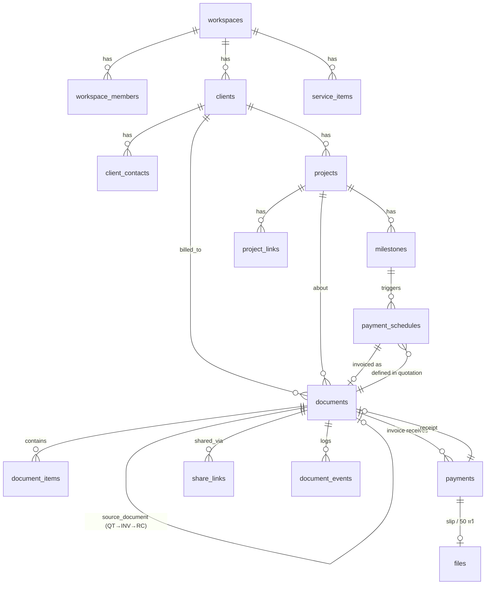

# WorkNest — Data Model (MVP)

อ้างอิง: [worknest.md](../worknest.md) (Spec v2) · SQL ฉบับร่าง: [db/schema.sql](../db/schema.sql)

สมมติฐาน: ใช้ **PostgreSQL** (เช่น Supabase) และใช้ Row Level Security แยกข้อมูลราย Workspace

---

## 1. ภาพรวมตาราง

| กลุ่ม | ตาราง | หน้าที่ |
|---|---|---|
| Workspace | `workspaces`, `workspace_members` | ข้อมูลผู้ให้บริการ (ผู้ขาย), ค่าตั้งต้นของเอกสาร, สมาชิก |
| ลูกค้า | `clients`, `client_contacts` | ลูกค้า (รวม Lead) และผู้ติดต่อ |
| บริการ | `service_items` | รายการบริการที่บันทึกไว้ |
| โปรเจกต์ | `projects`, `milestones`, `project_links` | โปรเจกต์, งวดงาน, ลิงก์ไฟล์ภายนอก |
| เอกสาร | `documents`, `document_items`, `document_number_sequences` | ใบเสนอราคา, ใบแจ้งหนี้, ใบเสร็จ, ใบส่งมอบ |
| การเงิน | `payment_schedules`, `payments` | งวดชำระ และการรับเงินจริง |
| ไฟล์ | `files` | สลิป, สัญญา, ใบ 50 ทวิ, โลโก้ |
| Portal | `share_links`, `document_events` | ลิงก์ให้ลูกค้า และหลักฐานเหตุการณ์ |
| ระบบ | `notification_log` | ประวัติการส่งแจ้งเตือน (กันส่งซ้ำ) |

ทุกตารางมีคอลัมน์ `workspace_id` (รวมตารางลูก) เพื่อให้ RLS ใช้ policy แบบเดียวกันทั้งหมดและ query ได้เร็ว

---

## 2. ER Diagram

---

## 3. ตารางหลัก

### 3.1 `workspaces`
ข้อมูลผู้ขายที่จะถูก Snapshot ลงเอกสาร และค่าตั้งต้นต่าง ๆ

| คอลัมน์ | หมายเหตุ |
|---|---|
| `legal_name`, `display_name` | ชื่อบนเอกสาร / ชื่อแสดงในระบบ |
| `tax_id`, `branch_code` | เลข 13 หลัก, `00000` = สำนักงานใหญ่ |
| `address`, `phone`, `email`, `logo_file_id` | |
| `promptpay_id` | เบอร์โทรหรือเลขผู้เสียภาษี ใช้สร้าง QR |
| `bank_accounts` jsonb | `[{bank, account_no, account_name}]` |
| `vat_registered` bool | ใช้ควบคุมการเปิดเอกสารภาษี (Later) |
| `default_quote_valid_days`, `default_credit_days`, `default_wht_rate` | |
| `doc_year_format` | `be` (พ.ศ.) หรือ `ce` |
| `doc_prefixes` jsonb | `{quotation:"QT", invoice:"INV", receipt:"RC", delivery_note:"DN"}` |

### 3.2 `clients`
| คอลัมน์ | หมายเหตุ |
|---|---|
| `kind` | `individual` / `company` |
| `name`, `tax_id`, `branch_code`, `address`, `email`, `phone` | |
| `status` | `lead` / `active` / `inactive` |
| `default_wht_rate` | numeric เช่น `3.00`; บริษัทตั้งค่าเริ่มต้นเป็น 3 |
| `source`, `notes` | |
| `archived_at` | Soft delete |

ป้องกันข้อมูลซ้ำด้วย unique `(workspace_id, tax_id, branch_code)` เมื่อ `tax_id` ไม่เป็น null

### 3.3 `projects` / `milestones`
- `projects.status`: `draft` / `confirmed` / `in_progress` / `review` / `completed` / `cancelled`
- `revisions_included`, `revisions_used`: ตัวนับรอบแก้ไขแบบเบาสำหรับ MVP (Spec หัวข้อ 10)
- `milestones.status`: `todo` / `in_progress` / `done`

### 3.4 `documents` (ตารางกลางของระบบ)
ใช้ตารางเดียวสำหรับเอกสารทุกประเภท แยกด้วย `type` เพราะโครงสร้างส่วนใหญ่ร่วมกัน (เลขที่, ลูกค้า, รายการ, ยอด, สถานะ, Snapshot)

| กลุ่มคอลัมน์ | คอลัมน์ |
|---|---|
| ระบุตัว | `type` (`quotation` / `invoice` / `receipt` / `delivery_note`), `number` (null ขณะเป็น Draft), `status` |
| ความสัมพันธ์ | `client_id`, `project_id`, `source_document_id` (ใบที่สร้างมาจาก), `replaces_document_id` (ฉบับที่ถูกแทนหลัง Void) |
| วันที่ | `issue_date`, `valid_until` (QT), `due_date` (INV) |
| ยอดเงิน | `subtotal`, `discount_amount`, `vat_rate`, `vat_amount`, `total`, `wht_rate`, `wht_amount`, `amount_payable` |
| เนื้อหา | `title`, `scope_of_work`, `exclusions`, `revisions_included`, `payment_terms`, `notes` |
| Snapshot | `seller_snapshot` jsonb, `buyer_snapshot` jsonb |
| เวลา | `issued_at`, `sent_at`, `first_viewed_at`, `responded_at`, `voided_at`, `void_reason` |

**สถานะ** (เก็บเฉพาะสถานะวงจรเอกสาร):
`draft` → `issued` → `sent` → `viewed` → `accepted` / `rejected` · `expired` · `void`

สถานะการชำระของใบแจ้งหนี้ **ไม่เก็บในคอลัมน์** แต่คำนวณจาก `payments` ผ่าน view `invoice_balances` (ดูข้อ 4.3)

### 3.5 `document_items`
`sort_order`, `service_item_id` (อ้างอิงเพื่อสถิติเท่านั้น), `description`, `quantity`, `unit`, `unit_price`, `discount_amount`, `amount`

### 3.6 `payment_schedules`
งวดชำระที่กำหนดในใบเสนอราคา

| คอลัมน์ | หมายเหตุ |
|---|---|
| `quotation_id`, `project_id`, `milestone_id` | งวดผูกกับ Milestone ได้ |
| `label` | เช่น "มัดจำ 50%" |
| `percent` หรือ `amount` | ต้องมีอย่างใดอย่างหนึ่ง |
| `due_rule` | `on_accept` / `on_milestone` / `fixed_date` + `due_date` |
| `invoice_id` | ใบแจ้งหนี้ที่ออกแล้วของงวดนี้ (null = ยังไม่ออก) |

### 3.7 `payments`
การรับเงินจริงแต่ละครั้ง (1 ใบแจ้งหนี้รับได้หลายครั้ง)

| คอลัมน์ | หมายเหตุ |
|---|---|
| `invoice_id`, `received_on` | |
| `cash_amount` | เงินที่เข้าบัญชีจริง |
| `wht_amount` | ยอดที่ลูกค้าหักไว้ |
| `method`, `reference`, `slip_file_id` | `transfer` / `promptpay` / `cash` / `cheque` / `other` |
| `wht_cert_status`, `wht_cert_file_id` | `not_applicable` / `pending` / `received` (ใบ 50 ทวิ) |
| `income_type` | `40_2` / `40_8` ใช้ทำสรุปยื่นภาษี (V2) |
| `receipt_id` | ใบเสร็จที่ออกจากการรับเงินครั้งนี้ |

### 3.8 `share_links` / `document_events`
- `share_links.token_hash`: เก็บเฉพาะ SHA-256 ของ token ส่วน token จริงอยู่ใน URL ที่ส่งให้ลูกค้าเท่านั้น
- `expires_at`, `revoked_at`
- `document_events`: `event` (`issued`, `sent`, `viewed`, `accepted`, `rejected`, `voided`, `payment_recorded` ฯลฯ), `actor` (`owner` / `client` / `system`), `actor_name`, `ip`, `user_agent`, `metadata`. **Append-only** ใช้เป็นหลักฐานการตอบรับ

---

## 4. กฎทางธุรกิจที่ระบบต้องบังคับ

### 4.1 เลขที่เอกสาร
- Draft ไม่มีเลขที่ เลขจะถูกออกตอน `draft → issued` เท่านั้น เพื่อไม่ให้เลขข้ามจากการทิ้ง Draft
- รูปแบบ: `{prefix}-{ปี}-{running 4 หลัก}` เช่น `QT-2569-0001`
- นับแยกตาม `(workspace, type, year)` ในตาราง `document_number_sequences` และออกเลขด้วย function `next_document_number()` ซึ่งใช้ `UPDATE … RETURNING` (atomic ไม่ชนกันแม้กดพร้อมกัน)
- Void แล้วเลขเดิมไม่ถูกนำกลับมาใช้

### 4.2 Immutability
- เมื่อ `status <> 'draft'` ห้ามแก้ยอดเงิน รายการ Snapshot ลูกค้า และเลขที่ (บังคับด้วย trigger ใน DB ไม่ใช่แค่ใน UI)
- เปลี่ยนได้เฉพาะสถานะและ timestamp ของวงจรเอกสาร
- ต้องการแก้ → `void` (ต้องระบุ `void_reason`) → สร้างฉบับใหม่โดยใส่ `replaces_document_id`

### 4.3 การคำนวณเงิน
- ใช้ `numeric(14,2)` เท่านั้น ห้ามใช้ float
- ลำดับการคำนวณ:
  1. `amount` ต่อรายการ = round(quantity × unit_price − discount, 2)
  2. `subtotal` = Σ amount
  3. ฐานภาษี = subtotal − discount_amount (ส่วนลดท้ายบิล)
  4. `vat_amount` = round(ฐาน × vat_rate / 100, 2) — เป็น 0 ถ้าไม่จด VAT
  5. `total` = ฐาน + vat_amount
  6. `wht_amount` = round(ฐาน × wht_rate / 100, 2) — **คิดจากยอดก่อน VAT**
  7. `amount_payable` = total − wht_amount
- ยอดคงค้างของใบแจ้งหนี้ (view `invoice_balances`):
  - `settled` = Σ(cash_amount + wht_amount) ของ payments
  - `outstanding` = total − settled
  - `payment_status` = `unpaid` / `partially_paid` / `paid` และ `overdue` เมื่อ outstanding > 0 และเลย `due_date`

### 4.4 การเปลี่ยนสถานะอัตโนมัติ
| เหตุการณ์ | ผล |
|---|---|
| ใบเสนอราคา → `accepted` | โปรเจกต์ `draft` → `confirmed` · ลูกค้า `lead` → `active` · งวด `on_accept` พร้อมให้ออกใบแจ้งหนี้ |
| Milestone → `done` | งวด `on_milestone` ที่ผูกอยู่ พร้อมให้ออกใบแจ้งหนี้ (MVP แจ้งเตือน, V2 สร้าง Draft อัตโนมัติ) |
| บันทึก payment | สร้างใบเสร็จจาก payment นั้นได้ในคลิกเดียว |
| เลย `valid_until` | ใบเสนอราคา → `expired` (job รายวัน) |

### 4.5 Snapshot
ตอน `issue` ให้คัดลอกข้อมูล workspace → `seller_snapshot` และข้อมูล client → `buyer_snapshot` แล้ว PDF ทุกครั้งต้อง render จาก Snapshot ไม่ใช่จากข้อมูลปัจจุบัน

---

## 5. Security

| เรื่อง | วิธี |
|---|---|
| แยกข้อมูล | RLS ทุกตาราง: `workspace_id` ต้องอยู่ใน workspace ที่ `auth.uid()` เป็นสมาชิก (function `is_workspace_member()`) |
| Portal ลูกค้า | **ไม่เปิด RLS ให้ anon** แต่ให้ API ฝั่ง server (Edge Function / Route Handler) รับ token → hash → หา share_link ที่ยังไม่หมดอายุและไม่ถูกเพิกถอน → คืนเฉพาะเอกสารนั้นด้วย service role |
| ไฟล์ | Storage bucket แบบ private, path `workspace_id/…`, เข้าถึงด้วย Signed URL อายุสั้น |
| หลักฐาน | `document_events` ห้าม update/delete (revoke สิทธิ์ + ไม่มี policy update/delete) |

---

## 6. View / Function ที่ต้องมี

| ชื่อ | ใช้ทำ |
|---|---|
| `invoice_balances` (view) | settled / outstanding / payment_status ต่อใบแจ้งหนี้ |
| `dashboard_summary(workspace_id)` | ยอดค้างรับ, บิลเลยกำหนด, เอกสารรอตอบรับ, Milestone ใกล้ครบกำหนด |
| `next_document_number(workspace_id, type, issue_date)` | ออกเลขที่เอกสารแบบ atomic |
| `is_workspace_member(workspace_id)` | ใช้ใน RLS policy |

---

## 7. เตรียมไว้สำหรับ V2 (ยังไม่สร้างตาราง)
- `change_requests` (เชื่อม `project_id`, `source_quotation_id`, ยอดเพิ่ม, ผลต่อกำหนดส่ง, สถานะเหมือนเอกสาร) หรือใช้ `documents.type = 'change_request'` ได้เลย ซึ่งน่าจะดีกว่าเพราะได้เลขที่ Portal และ events ฟรี
- `agreements` → `documents.type = 'agreement'`
- `client_activities` (ประวัติการติดต่อ)
- `tags`, `client_tags`
